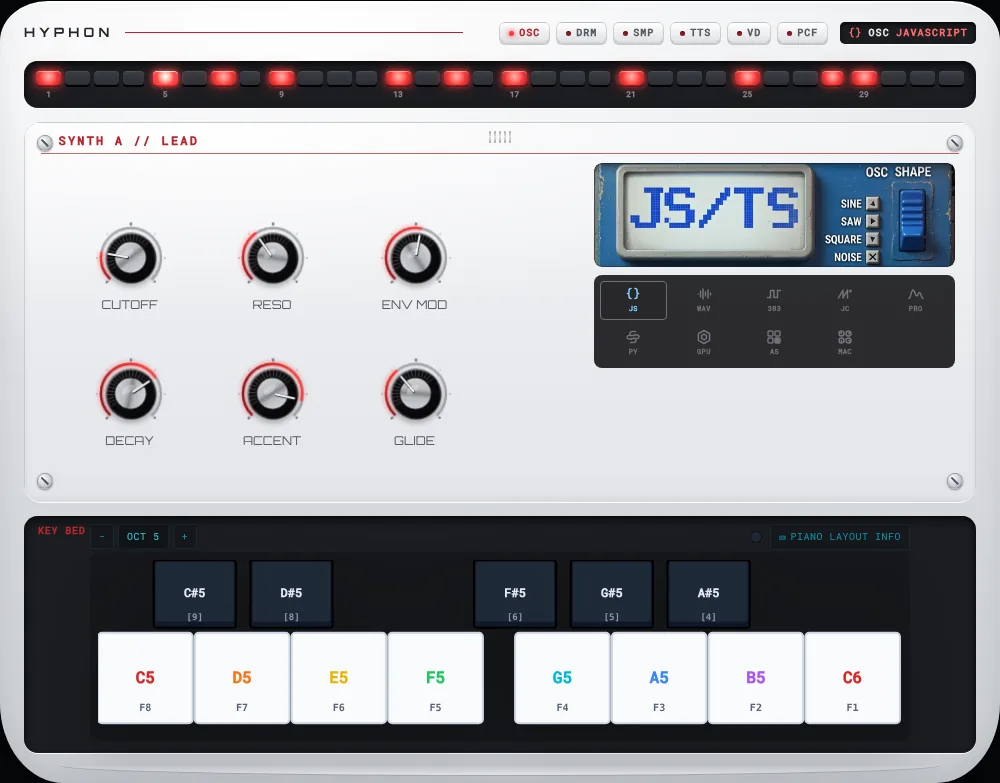
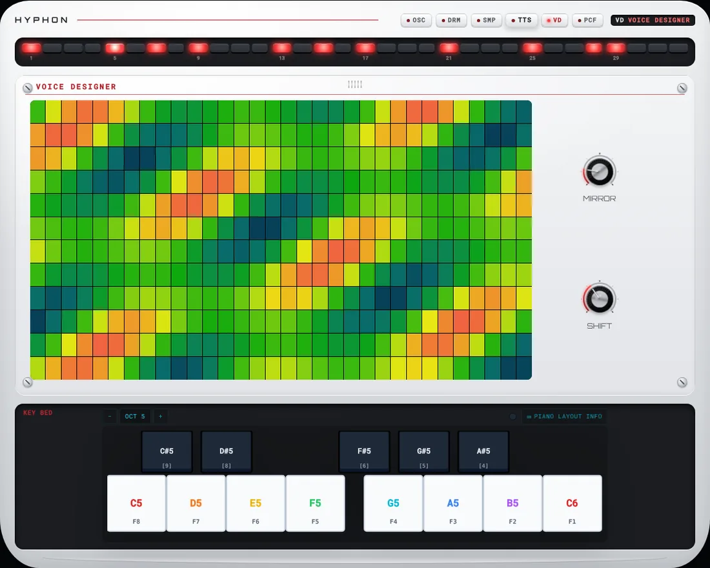
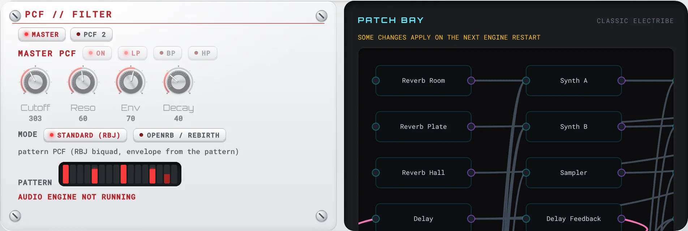
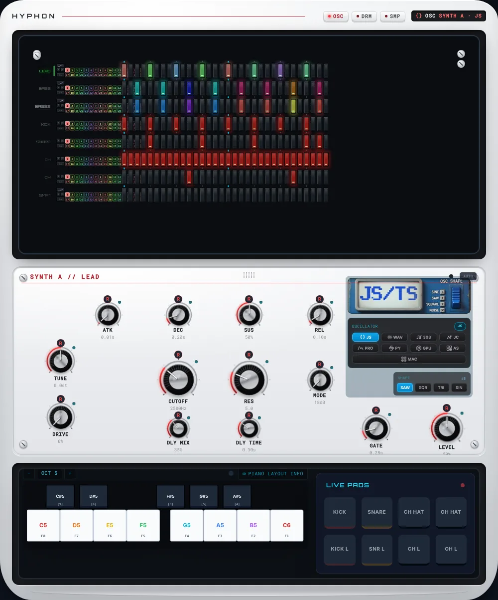

# Expandable hardware chassis (#1580)

The main instrument panels can sit inside one **transforming white hardware chassis**: a rounded white body with a fixed LED step strip on top, a fixed key bed at the bottom, and a stage between them that grows and narrows as you move between oscillator, drum, sampler, TTS, Voice Designer and PCF interfaces. It is meant to read as one instrument changing shape, not a stack of separate floating panels.

Everything is **opt-in**. Without the flag the app renders exactly as before.

| Try it | URL |
|---|---|
| Live app inside the chassis | `/?chassis=white` (also `?chassis` or `?chassis=1`) |
| Review page (no audio boot) | `/?visual-review=1` → *Expandable hardware chassis*, *Knob caps*, *Oscillator panel art* |

---

## How it is opted into

There are three switches, and each is scoped:

1. **`data-chassis="white"`** turns on the tokens and materials in `src/styles/chassis.css`. Every rule there is scoped under the attribute or under `.hyphon-chassis*` / `.hyphon-osc-art*` / `.hyphon-knob-led` classes that only chassis components render.
2. **`ChassisKnobMaterialContext`** (`src/components/chassis/chassisContext.ts`) is provided by `HardwareChassis` around its stage. `HardwareModule` reads it, so every rack module on the stage gets `KNOB_MATERIAL_CHASSIS` knobs and status LEDs with no new props at the call sites. `<ChassisOnly>` renders its children only on a stage. The oscillator panel art and the selector icons use it.
3. **`KnobMaterial.cap`**: a material with a `cap` renders a physical knob in all three knob renderers. `KNOB_MATERIAL` has no cap, so default knobs are unchanged. The default WGSL is byte-identical; the inline snapshot in `wgsl.contract.test.ts` pins it.

No event handlers on knobs, step buttons, pads or keys were added, removed or reordered. Styling uses classes and `data-*` attributes only.

---

## Files

| File | Role |
|---|---|
| `src/styles/chassis.css` | `[data-chassis="white"]` tokens (#1589), body / well / silkscreen / pad materials, container + stage morph, rack-panel overrides, panel-art frame, knob LED, reduced-motion + forced-colors blocks |
| `src/components/chassis/HardwareChassis.tsx` | The container (#1584): head (brand, print rule, mode keys, LCD badge), LED-strip well, morphing stage with primary + optional secondary panel, key-bed well, optional fixed footer well (#1586) |
| `src/components/chassis/chassisModes.ts` | Modes, footprints, per-mode secondary layout, track → mode mapping, panel modes (PCF) and their resolution, `?chassis` parser |
| `src/components/chassis/ChassisPcfDeck.tsx` | PCF mode (#1586): `ChassisPcfPlate` (primary — `PatchBayPcfPanel` on a white plate, master or placed PCF) and `ChassisPatchDeck` (`side` secondary — `PatchBay` in a dark well) |
| `src/components/chassis/ChassisLedStrip.tsx` | Presentational 32-step silicone pad strip (`data-on` / `data-playhead`) |
| `src/components/chassis/OscillatorPanelArt.tsx` | `public/osc/*.webp` artwork per family (#1583): `header` faceplate or `backdrop` (controls on top) |
| `src/components/chassis/OscillatorSignatureIcon.tsx` | One 16×16 glyph per family (#1587), `currentColor` |
| `src/components/chassis/chassisContext.ts`, `ChassisOnly.tsx` | Stage context + guard |
| `src/components/appParts/ChassisNode.tsx` | Live layout: sequencer = top anchor, rack = primary panel, voice deck = `below` secondary in TTS / VD, PCF plate + patch bay in PCF, keyboard = bottom anchor, master strip = footer. Lazy-loaded; the live nodes are passed in from `App.tsx` (like `Studio3D`), so they stay in the entry bundle |
| `src/components/knobCapRender.ts` | Canvas 2D cap layers (static / dynamic split) |
| `src/components/knobCapShader.ts` | WGSL cap fragment |
| `src/components/KnobCapSvg.tsx` | Classic-mode SVG cap |
| `src/components/sequencer/playhead.ts` | `setStepPlayhead`: toggles `is-current` + `data-playhead` together on the one playhead step per row (#1589) |
| `src/components/ui/ChassisShowcase.tsx`, `ChassisMaterialsShowcase.tsx`, `ChassisSurfacesShowcase.tsx` | Review sections. PCF mode mounts an offline `PatchController` (classic preset + one placed PCF) so the real plate and patch bay render without an audio engine |

---

## Modes and footprints

The LED strip and key bed never move. Only `--chassis-stage-h` (stage height) and `--chassis-max-w` (body width) change, through CSS transitions (`CHASSIS_MORPH_MS` = 420 ms, `cubic-bezier(.22,.9,.24,1)`, written to `--chassis-morph-duration` by the component).

| Mode | Code | Stage (px) | Compact (px) | Body max width (px) | Secondary | Live today |
|---|---|---|---|---|---|---|
| Oscillator | OSC | 380 | 320 | 1000 | — | ✅ Synth A / Synth B / Bass 2 |
| Drum voice | DRM | 340 | 290 | 1000 | — | ✅ Kick / Snare / hats |
| Sampler | SMP | 420 | 340 | 1000 | — | ✅ Sampler |
| Voice / TTS | TTS | 640 | 540 | 1060 | `below`, fits content | ✅ Sampler rack + voice deck |
| Voice Designer | VD | 720 | 600 | 1180 | `below`, fits content | ✅ Sampler rack + expanded voice deck |
| Filter (PCF) | PCF | 320 | 270 | 1000 | `side`, 50% | ✅ Filter plate + patch bay (panel mode) |

The oscillator stage keeps the legacy rack height (380 px), so live panels do not reflow. The live mode keys select a track: OSC goes to Synth A (or keeps the current synth), DRM to Kick, SMP / TTS / VD to Sampler. The LCD badge names the track and, for synths, the oscillator family with its signature icon.

### Expansion modes: track modes and panel modes (#1586)

Every interface on the chassis expands and collapses the same way: a mode key (or a track selection) changes the footprint, the stage morphs, and the content fades in once the size settles. There are two kinds of mode:

| Kind | Modes | Primary | Secondary | Opens | Collapses |
|---|---|---|---|---|---|
| Track | OSC, DRM, SMP | The rack, showing the selected track | — | Its key selects a matching track; selecting a track anywhere opens its mode | Another mode key or track |
| Track (sampler views) | TTS, VD | The rack (sampler) | Voice deck, `below` | Sampler track opens the last sampler view (default TTS) | SMP key, or any other track |
| Panel | PCF | `ChassisPcfPlate` | `ChassisPatchDeck`, `side` 50% | PCF key, over whichever track is selected; it selects no track | Any track mode key returns to the current track's mode. Selecting another track (sequencer, pads…) collapses it for good, so coming back to the first track does not reopen it |

`resolveChassisMode(track, samplerMode, panel)` decides which mode the stage shows. `chassisModeHidesRack(mode)` is true for panel modes. The rack is **never unmounted**: it is the first child of the primary in every mode, and a panel mode only sets `hidden` on it while the panel's own primary sits beside it. Rack state and GPU knob slots survive PCF opening and closing, as they do for the voice deck.

### PCF mode: filter plate + patch bay

- **Filter plate** (primary): `PatchBayPcfPanel`, the same component and the same `PatchController.setPcf` edits the patch bay uses, rendered on a white rack plate. Inside a chassis it switches to its chassis skin, picked from `ChassisKnobMaterialContext` like every other chassis visual: chassis knobs (`HardwareKnob` with the stage's knob material) instead of range sliders, chassis keys for On / LP / BP / HP / filter mode, and the pattern as LED bars in a dark well. Outside a chassis it renders exactly as before. The plate drives the master PCF by default. When the patch has placed PCFs, a row of keys picks which one, and selecting a PCF node on the graph moves the plate to it. While the master PCF is not running its song knobs are locked (`inert`, dimmed), as in the patch bay.
- **Patch deck** (secondary): `PatchBay` in a dark well, like the voice deck. `showPcfControls={false}` leaves PCF controls to the plate, and `onSelectPcfNode` hands PCF selections to it.
- The oscillator theme / accent is dropped while PCF owns the stage. The LCD badge reads `PCF · Master PCF · Patch bay` (or the placed node).

### Nothing floats outside the chassis

Under `?chassis=white`, `App.tsx` no longer renders the collapsible *Patch Bay* `
` or the standalone master loudness strip under the instrument. The patch bay opens on the stage with the PCF key, and `MasterLoudnessMeter` is the chassis's **footer**: a fixed dark well under the key bed that never morphs, like the LED strip and key bed. The default layout keeps both where they were.

Song mode, session, arrangement, piano roll, the lyric track and the modals are app views and overlays rather than instrument panels, so they stay outside the chassis.

### Secondary panel

`HardwareChassis` hosts a **primary** panel (`children`) and an optional **secondary** (`secondary`). Passing secondary content opens it; omitting it (or `null` / `false`) closes it. The primary is always the first child of the stage, so it never remounts when the secondary opens or closes. The rack and its GPU knob slots survive the TTS deck coming and going.

- **Placement**: `side` (a column beside the primary) or `below` (a row under it). It comes from the mode's `secondary.placement`, and the `secondaryPlacement` prop overrides it.
- **Share**: the fraction of the stage the secondary takes along its split axis (`secondary.share` / `secondaryShare`). `side` defaults to 0.4. `below` without a share sizes to its content, which is how the voice deck works.
- **Narrow screens** (≤ 640 px): a `side` secondary stacks under the primary. The stage grows by the secondary's share (`--chassis-stage-h-stacked`), so the primary keeps the mode's full height.
- The secondary sits inside `ChassisKnobMaterialContext`, so rack modules there get chassis knobs too.

### Motion: why the morph does not jank

On `main` before #1584 the panel was `inset: 0` inside the animating stage. Every frame of the 420 ms morph resized the hosted rack, its knob-rack `ResizeObserver` re-laid every knob canvas, and the content was visible while it reflowed. Measured on the review page (headless Chromium), each mode change caused **9 resizes** of the hosted panel, and its content was visible from about 50 ms in.

Now:

1. **The panel is laid out at the target size.** It is `width: var(--chassis-stage-w)` / `height: var(--chassis-stage-h)`, positioned top-left in the stage. `--chassis-stage-w` is measured by `HardwareChassis`: the parent's content box, capped at the mode's max width, minus the body padding. It is re-measured on a mode change and when the parent resizes. The stage animates its own height and width and clips. Result: **1 resize per mode change**, and the panel equals the stage once the morph ends.
2. **Content waits for the size.** On a footprint change (stage height, body width, or secondary open / placement), the panel is hidden and fades in over 180 ms from `CHASSIS_CONTENT_DELAY_MS` = 300 ms. With this ease-out curve the size is about 99% settled by then. A newly opened secondary slides in 60 ms after the primary. A panel change within one footprint (Synth A → Synth B) still plays the quick 360 ms entry with no wait.
3. **`data-morphing`** is set on the body for the duration of the morph, for hosted panels that want to defer heavy work.
4. A change mid-morph cancels the running animations before starting the next.

All of this is Web Animations on the existing nodes, not keyed remounts, so panel state survives.

## Knob caps (#1581)

`KNOB_MATERIAL_CHASSIS` has a black knurled cap with a brushed-metal top, a red LED value arc printed on the panel, grey silkscreen ticks and a soft contact shadow. Its `cap` and `lighting` blocks are read by all three renderers:

| Renderer | Path | Notes |
|---|---|---|
| WebGPU | `buildKnobShaderCode(material)` → `buildKnobCapShaderCode` | Height-field cap → normal → Blinn-Phong. Knurl and brush are fixed to the cap, so they **rotate with the value**. The specular highlight is fixed to the light. Premultiplied output. `KnobGPUContext.register(canvas, getValue, material)` compiles **one pipeline per material**, shared by every knob that uses it. |
| Canvas 2D | `buildKnob2DDrawCalls` → `buildKnobCapLayers` | Layered gradients. The **static layer** (track, ticks, shadow, skirt shading) is cached per material × size × DPR (48-entry LRU). Only the **dynamic layer** (lit arc, knurl, brushed top, pointer, highlight) replays on a value change. No background fill, so it composes on white or dark. |
| Classic SVG | `HardwareKnob mode="classic"` → `KnobCapSvg` | Gradients, `feDropShadow`, knurl ticks and a pointer in a rotating group, with a static highlight. `useId()` keeps gradient ids unique. |

**Dark panels.** `KNOB_MATERIAL_CAP_DARK` is the same cap for dark legacy panels: light silkscreen ticks and a graphite track that read on `#0d0f13`, the default cyan value arc, a subtler contact shadow and a brighter skirt rim (`cap.rimHighlight`, default 0.12, 0 disables). All three renderers draw the rim. In Canvas 2D it sits in the cached static layer. Pick the cap material once per panel with `knobCapMaterialForSurface('light' | 'dark')`, matching the panel's `data-surface`. Do not pick it per knob.

Inside a chassis, `HardwareModule` also renders a small **status LED** at each knob's top-right in the part colour. It is lit when the parameter is automated, recording or receiving MIDI.

---

## Panel artwork (#1583) and icons (#1587)

`OSCILLATOR_PANEL_IMAGES` is now used. `oscillatorPanelImageUrl(type)` resolves it against Vite's `BASE_URL` (the build uses `./`, so it works under `/hyphon/`). `OSCILLATOR_PANEL_FOCUS` keeps each family's title or LCD in view when the art is cover-cropped. On the chassis stage, the oscillator column of Synth A, Synth B and Bass 2 gets a faceplate header that swaps (with a 320 ms fade) when the family changes. If a file is missing, the header falls back to the themed label instead of a broken image. `scripts/check-release-dist.mjs` still reads the `'/osc/…'` strings, so the map's format is unchanged.

`OscillatorTypeSelector` shows each family's signature icon next to its badge **only on a chassis stage**.

---

## Accessibility

- **Reduced motion**: the global rule in `accessibility.css` neutralises every CSS transition and animation here. `chassis.css` also drops the stage / art entry animations and the mode-key press transform. The Web Animations reveals (panel entry, content fade, secondary slide) and `data-morphing` are skipped when `prefers-reduced-motion` is on (`getPrefersReducedMotion`).
- **Forced colors**: lit pads, the playhead pad, the pressed mode key and the knob LED get an outline or system colour, because `forced-colors` drops `box-shadow`.
- **Contrast** (`src/__tests__/chassisContrast.test.ts`): red print `#b3262e` on the body `#eceef0` is about 5.6:1. Muted print and body ink are ≥ 4.5:1. The owner's `--chassis-print-muted: #6b6f76` measured about 4.4:1 on the body, so it is darkened to `#575b62`.
- Mode keys are `aria-pressed` buttons in a labelled group. The LCD badge is `role="status"`. LEDs and decorative layers are `aria-hidden`. Knob sliders keep their names.

---

## Bundle impact

Measured with `vite build` against `main` (`f6894c7`):

- Code the default page now loads: about **+23 KB raw** (cap renderer + shader, art / icon components, chassis context). Measured as the entry plus its static import closure: 1,768,156 → 1,792,017 bytes.
- Entry chunk: 234,157 → 222,975 bytes brotli (budget 262,000). Rolldown moved a few modules into separate preloaded chunks, so the entry is smaller even though the total grew.
- `ChassisNode` + `HardwareChassis` are a lazy chunk fetched only under `?chassis`. The review sections are in the lazy `VisualStyleShowcase` chunk. They use `HardwareKnob`, not `HardwareModule`, on purpose: a static `HardwareModule` import from that chunk made Rolldown regroup the entry chunk (+47 KB raw).

---

## Status against the epic

| Sub-issue | State in this slice |
|---|---|
| #1589 tokens + materials | Done: tokens, body / well / silkscreen / label, step-pad material (chassis LED strip), contrast test, live step grid (`.svg-step[data-on]` / `[data-playhead]`, SVG `fill` / `filter`), `DrumPads` `.live-pad` + `data-hit`, `LiveKeyboard` `data-key` / `data-down` + key LEDs (`ledNotes` prop), review section *White-chassis surfaces*. **Not yet:** nothing feeds `ledNotes` in the live layout (needs a scale / pattern source). |
| #1581 knob 3D | Done: material contract, WGSL, Canvas 2D with cached static layers, classic SVG, LED dot, per-material GPU pipelines. |
| #1584 container + expansion | Done: `HardwareChassis`, modes / footprints, mode badge, compact layout, live `?chassis=white`, secondary panel (`side` / `below`) with reveal, target-size hold (one content resize per morph), content fade after the size settles. |
| #1583 `public/osc` panels | Done for the oscillator columns (header faceplate). The `backdrop` variant exists for full-panel art. |
| #1587 icons | Done: nine glyphs, used in the selector (on a chassis stage) and the LCD badge. |
| #1585 oscillator migration | Synth A / B / Bass 2 render on the chassis plate with chassis knobs, art and icons. The controls themselves are unchanged. |
| #1582 Sampler / TTS / Voice Designer | Live: SMP shows the rack. TTS / VD open the voice deck (phrase, GEN, Voice Designer heatmap) as the chassis's `below` secondary. |
| #1586 PCF + rest | Done: PCF is a live panel mode. `PatchBayPcfPanel` (chassis skin) is the primary, the patch bay is the `side` secondary, the rack stays mounted underneath. The master strip is the chassis footer. Nothing from the instrument floats outside the chassis under `?chassis=white`. |
